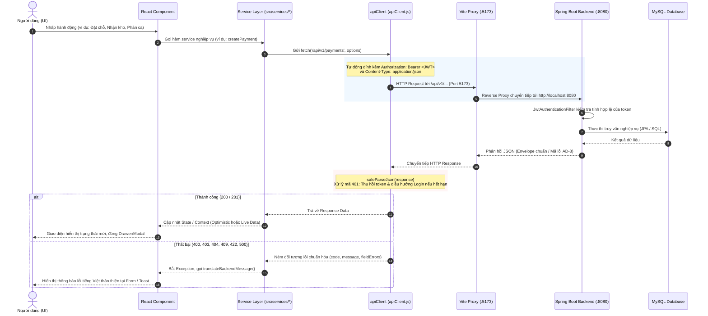
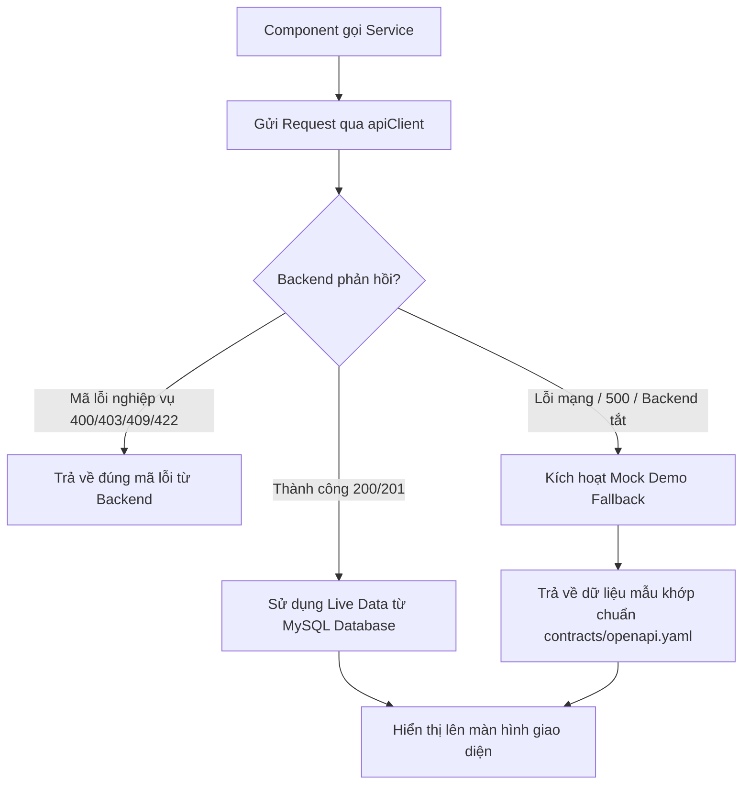

# Kiến Trúc Luồng Dữ Liệu & Giao Tiếp Mạng (Data Flow & Communication)

Tài liệu này mô tả chi tiết cách thức Frontend StorageHub khởi tạo, xử lý và trao đổi dữ liệu với máy chủ Backend Spring Boot, quy trình xác thực JWT, cơ chế bảo vệ phiên làm việc và chiến lược Fallback an toàn.

---

## 1. Sơ Đồ Luồng Dữ Liệu Tổng Thể (End-to-End Data Flow)

Dưới đây là sơ đồ Mermaid minh họa vòng đời của một yêu cầu (Request Lifecycle) từ khi người dùng tương tác trên giao diện người dùng đến khi dữ liệu được cập nhật trên màn hình:



---

## 2. Chi Tiết Lớp Giao Tiếp Mạng (`frontend/src/services/apiClient.js`)

`apiClient` là tầng mạng trừu tượng cốt lõi của toàn bộ ứng dụng, được cấu hình để giải quyết các bài toán quan trọng sau:

### 2.1. Quản Lý Khóa Phiên & Lưu Trữ Token (`tokenStorage`)
Token JWT được lưu trữ an toàn trong `localStorage` dưới khóa `storagehub_token`:
- Khi người dùng đăng nhập thành công, token được lưu qua `tokenStorage.set(token)`.
- Thông tin định danh giải mã từ JWT (`userId`, `email`, `role`) được lưu tại `storagehub_user`.
- Khi người dùng bấm Đăng xuất hoặc bị máy chủ thu hồi phiên, `tokenStorage.clear()` sẽ dọn dẹp sạch toàn bộ các khóa liên quan, ngăn ngừa rò rỉ quyền hạn giữa các phiên làm việc.

```javascript
// frontend/src/services/apiClient.js
const TOKEN_KEY = "storagehub_token";

export const tokenStorage = {
  get: () => localStorage.getItem(TOKEN_KEY),
  set: (token) => localStorage.setItem(TOKEN_KEY, token),
  clear: () => {
    localStorage.removeItem(TOKEN_KEY);
    localStorage.removeItem("storagehub_user");
    localStorage.removeItem("storagehub_expires_at");
  },
};
```

### 2.2. Request Interceptor Tự Động Gắn Header
Mọi request phát sinh từ Frontend đều tự động được chèn các header chuẩn:
1. `Content-Type: application/json` (trừ khi request dạng multipart gửi ảnh hợp đồng).
2. `Authorization: Bearer <token>` nếu người dùng đã đăng nhập và tồn tại token trong bộ nhớ.

```javascript
export async function apiClient(endpoint, options = {}) {
  const token = tokenStorage.get();

  const headers = {
    "Content-Type": "application/json",
    ...options.headers,
  };

  if (token) {
    headers["Authorization"] = `Bearer ${token}`;
  }

  const response = await fetch(endpoint, {
    ...options,
    headers,
  });
  // ...
}
```

### 2.3. Response Interceptor & Xử Lý Mã 401 Unauthorized
Khi Backend trả về mã trạng thái `401 Unauthorized` (do token hết hạn sau 24h hoặc secret không hợp lệ):
- `apiClient` kiểm tra xem endpoint hiện tại có phải là luồng xác thực công khai hay không (`/auth/login`, `/auth/register`...).
- Nếu đang ở trang yêu cầu quyền hạn và trước đó đã có phiên hợp lệ (`hadSession === true`), hệ thống tự động:
  1. Xóa sạch token khỏi storage (`tokenStorage.clear()`).
  2. Chuyển hướng người dùng về trang `/login`.
  3. Ném thông báo lỗi tiếng Việt: *"Phiên đăng nhập đã hết hạn. Vui lòng đăng nhập lại."*
- Nếu người dùng đang duyệt danh mục công khai (`/browse`, `/units/:id`), hệ thống giữ nguyên vị trí duyệt mà không làm phiền người dùng bằng việc ép chuyển hướng.

### 2.4. Trình Phân Tích JSON An Toàn (`safeParseJson`)
Trong kiến trúc REST API, nhiều phản hồi có thể trả về thân rỗng (như `204 No Content`, `HEAD` request, hoặc lỗi ngắt kết nối `502 Bad Gateway` từ proxy dạng HTML).  
Nếu dùng trực tiếp `response.json()`, trình duyệt sẽ ném lỗi nghiệm trọng `SyntaxError: Unexpected end of JSON input`.  
Hàm `safeParseJson` giải quyết dứt điểm vấn đề này:

```javascript
export async function safeParseJson(response) {
  try {
    const text = await response.text();
    if (!text || !text.trim()) {
      return {};
    }
    return JSON.parse(text);
  } catch {
    return {
      message:
        response.status >= 500
          ? "Không thể kết nối tới máy chủ. Vui lòng kiểm tra kết nối mạng và thử lại."
          : `Máy chủ phản hồi mã trạng thái ${response.status}`,
    };
  }
}
```

---

## 3. Chiến Lược Hybrid Fallback & Đồng Bộ Live API

Để đảm bảo quy trình phát triển và kiểm thử không bị gián đoạn khi Backend đang bảo trì, nâng cấp seed hoặc cấu hình lại cơ sở dữ liệu, các service Frontend được thiết kế theo cơ chế **Hybrid Architecture**:



### 3.1. Nguyên Tắc Của Fallback
1. **Ưu tiên hàng đầu cho Live Backend**: Khi máy chủ Backend đang chạy trên cổng `8080`, 100% request được chuyển trực tiếp vào Database thực thông qua Spring Data JPA và Flyway migrations.
2. **Kích hoạt Fallback khi và chỉ khi**:
   - `fetch()` ném lỗi `TypeError: Failed to fetch` (Backend chưa khởi động hoặc cổng bị đóng).
   - Backend phản hồi mã lỗi hệ thống nghiêm trọng `status >= 500`.
3. **Tính toàn vẹn của dữ liệu mẫu**: Toàn bộ dữ liệu mock trong các service (`DEMO_RESERVATIONS`, `INITIAL_UNITS`, `INITIAL_SHIFTS`, `INITIAL_USERS`) đều phản ánh chính xác cấu trúc bảng V3 và tương ứng với bộ seed `V2` đến `V18` trong Backend.

---

## 4. Quản Lý Trạng Thái Ứng Dụng (State Management)

Hệ thống kết hợp giữa **Global Context** (cho dữ liệu dùng chung toàn ứng dụng) và **Local State / Optimistic Updates** (cho các thao tác cục bộ trên màn hình).

### 4.1. AuthContext (`frontend/src/context/AuthContext.jsx`)
Cung cấp trạng thái xác thực tập trung cho toàn bộ ứng dụng:
- **`user`**: Đối tượng người dùng hiện tại `{ id, email, fullName, role, facilityId }`.
- **`token`**: Chuỗi JWT hợp lệ.
- **`isAuthenticated`**: Boolean kiểm tra nhanh trạng thái đăng nhập.
- **`login(email, password)`**: Hàm gửi yêu cầu xác thực tới `POST /api/v1/auth/login`. Nếu thành công, tự động lưu token và giải mã payload JWT để lấy vai trò.
- **`logout()`**: Xóa token và đưa người dùng về trang `/browse`.
- **`hasRole(roles)`**: Kiểm tra xem người dùng có quyền thực thi thao tác đó hay không.

### 4.2. NotificationContext (`frontend/src/context/NotificationContext.jsx`)
- Quản lý danh sách thông báo và số lượng thông báo chưa đọc (`unreadCount`).
- Tự động gọi API `GET /api/v1/notifications/unread-count` để cập nhật huy hiệu chuông thông báo trên Header.
- Hỗ trợ thao tác `markAllAsRead()` qua endpoint `POST /api/v1/notifications/mark-all-read`.

### 4.3. Cập Nhật Lạc Quan (Optimistic Updates)
Để tăng tốc độ trải nghiệm và độ mượt mà của giao diện (zero-latency perceived performance), một số màn hình phức tạp áp dụng kỹ thuật cập nhật lạc quan:
- **Kanban Task Board (`TaskBoardPage.jsx`)**: Khi nhân viên kéo thả thẻ công việc từ cột `TODO` sang `IN_PROGRESS` hoặc `DONE`, giao diện lập tức dời thẻ sang cột đích trước, sau đó gửi request ngầm `PATCH /api/v1/tasks/{id}/status`. Nếu máy chủ phản hồi lỗi (ví dụ: vi phạm ràng buộc trạng thái), thẻ sẽ tự động hoàn tác về vị trí cũ kèm thông báo giải thích.
- **Bảng ca trực (`StaffShiftsPage.jsx`)**: Phát hiện xung đột trùng giờ giữa các ca trực ngay trên máy client (`detectShiftConflict`) trước khi gửi lên máy chủ, ngăn chặn lỗi 409 ngay từ bước nhập liệu.

---

## 5. Chuẩn Hóa Lỗi & Bản Địa Hóa (Vietnamese Error Localization)

Tuân thủ quyết định kiến trúc **AD-8**, mọi phản hồi lỗi từ Backend đều nằm trong cấu trúc Envelope:

```json
{
  "code": "RESERVATION_CONFLICT",
  "message": "Kho đã có khách đặt trước trong khoảng thời gian này.",
  "fieldErrors": [
    {
      "field": "startDate",
      "message": "Ngày bắt đầu bị trùng với đơn đặt chỗ hiện hữu."
    }
  ]
}
```

### Bảng Ánh Xạ Mã Lỗi Thông Dụng Sang Tiếng Việt (`src/utils/statusLabels.js`):

| Mã Lỗi Backend (`code`) | Thông Điệp Tiếng Việt Thân Thiện |
|---|---|
| `AUTH_TOKEN_INVALID` | Phiên đăng nhập không hợp lệ hoặc đã hết hạn. Vui lòng đăng nhập lại. |
| `ACCESS_DENIED` | Bạn không có quyền thực hiện thao tác này. |
| `UNIT_ALREADY_RESERVED` | Đơn vị kho này vừa được khách hàng khác giữ chỗ. Vui lòng chọn kho khác. |
| `PAYMENT_EXPIRED` | Phiên thanh toán đã hết thời gian chờ (5 phút). Vui lòng tạo phiên mới. |
| `INVALID_OTP` | Mã xác thực OTP không chính xác. Vui lòng thử lại. |
| `SNAP_BACK_VIOLATION` | Không thể hoàn thành công việc: Chưa hoàn tất các nghi thức bắt buộc (chụp ảnh hợp đồng / kiểm tra vệ sinh). |
| `EXTENSION_DATE_COLLISION` | Ngày gia hạn vượt quá mốc bắt đầu của đơn thuê tiếp theo trên cùng kho. |
| `POLICY_RULE_CAP_EXCEEDED` | Tỷ lệ phụ thu vượt quá mức trần tối đa cho phép trong quy định. |
| `BACKEND_UNAVAILABLE` | Không thể kết nối tới máy chủ Backend (Port 8080). Vui lòng kiểm tra dịch vụ. |
