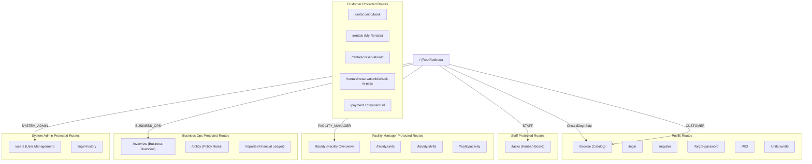

# Định Tuyến & Ma Trận Phân Quyền (Routing & Authorization)

Tài liệu này cung cấp chi tiết về kiến trúc định tuyến phía máy khách (Client-side Routing), quy trình kiểm tra quyền hạn dựa trên vai trò (Role-Based Access Control - RBAC), cơ chế bảo vệ Route và hành vi đồng bộ hóa của thanh điều hướng (Header).

---

## 1. Cấu Trúc Cây Định Tuyến (React Router DOM v7)

Toàn bộ hệ thống định tuyến được khai báo tập trung tại [`frontend/src/app/router.jsx`](file:///D:/Workspace/StorageHub/frontend/src/app/router.jsx). Các route được chia thành 8 phân nhóm rõ rệt:



---

## 2. Ma Trận Phân Quyền Theo Vai Trò (Role Access Matrix)

Hệ thống hỗ trợ 5 vai trò (Role) nghiệp vụ với phạm vi truy cập nghiêm ngặt:

| Đường Dẫn (Route) | Mục Đích Màn Hình | Public | CUSTOMER | STAFF | FACILITY_MANAGER | BUSINESS_OPS | SYSTEM_ADMIN |
|---|---|:---:|:---:|:---:|:---:|:---:|:---:|
| `/browse` | Duyệt danh mục kho | ✅ | ✅ | ✅ | ✅ | ✅ | ✅ |
| `/units/:unitId` | Xem thông số kỹ thuật kho | ✅ | ✅ | ✅ | ✅ | ✅ | ✅ |
| `/login`, `/register` | Đăng nhập / Đăng ký | ✅ | ❌ | ❌ | ❌ | ❌ | ❌ |
| `/units/:unitId/book` | Đặt giữ chỗ kho | ❌ | ✅ | ❌ | ❌ | ❌ | ✅ |
| `/rentals` | Danh sách đơn thuê của tôi | ❌ | ✅ | ❌ | ❌ | ❌ | ✅ |
| `/rentals/:id` | Chi tiết hợp đồng & dòng tiền | ❌ | ✅ | ❌ | ❌ | ❌ | ✅ |
| `/rentals/:id/check-in-pass` | Mã QR & PIN nhận kho | ❌ | ✅ | ❌ | ❌ | ❌ | ✅ |
| `/payment` | Modal / Cổng thanh toán | ❌ | ✅ | ❌ | ❌ | ❌ | ✅ |
| `/tasks` | Bảng Kanban tác vụ nhân viên | ❌ | ❌ | ✅ | ✅ | ❌ | ✅ |
| `/facility` | Tổng quan tỷ lệ lấp đầy cơ sở | ❌ | ❌ | ❌ | ✅ | ❌ | ✅ |
| `/facility/units` | Đổi trạng thái / Bảo trì kho | ❌ | ❌ | ❌ | ✅ | ❌ | ✅ |
| `/facility/shifts` | Phân ca & lịch trực tuần | ❌ | ❌ | ❌ | ✅ | ❌ | ✅ |
| `/facility/activity` | Kiểm toán nhật ký cơ sở | ❌ | ❌ | ❌ | ✅ | ✅ | ✅ |
| `/overview` | Tổng quan kinh doanh | ❌ | ❌ | ❌ | ❌ | ✅ | ✅ |
| `/policy` | Quản lý chính sách giá & trần | ❌ | ❌ | ❌ | ❌ | ✅ | ✅ |
| `/reports` | Báo cáo doanh thu & biểu đồ | ❌ | ❌ | ❌ | ❌ | ✅ | ✅ |
| `/users` | Quản lý người dùng, đổi quyền | ❌ | ❌ | ❌ | ❌ | ❌ | ✅ |
| `/login-history` | Lịch sử đăng nhập toàn hệ thống| ❌ | ❌ | ❌ | ❌ | ❌ | ✅ |
| `/support` | Trung tâm trợ giúp / ticket | ❌ | ✅ | ✅ | ✅ | ❌ | ✅ |

> **Ghi chú về SYSTEM_ADMIN:** Quản trị viên hệ thống (Nam) có quyền truy cập toàn diện trên hầu hết mọi màn hình nhằm mục đích kiểm tra và xử lý sự cố vận hành khẩn cấp.

---

## 3. Cơ Chế Hoạt Động Của `ProtectedRoute.jsx`

Component [`ProtectedRoute`](file:///D:/Workspace/StorageHub/frontend/src/components/ProtectedRoute/ProtectedRoute.jsx) đóng vai trò là "chốt gác" an ninh cho mọi trang cần xác thực:

```jsx
// frontend/src/components/ProtectedRoute/ProtectedRoute.jsx
export default function ProtectedRoute({ children, allowedRoles = [] }) {
  const { user, isAuthenticated, loading } = useAuth();
  const location = useLocation();

  if (loading) {
    return <div className="sh-loading-spinner">Đang xác thực...</div>;
  }

  // 1. Nếu chưa đăng nhập -> Chuyển hướng về Login (lưu lại trang đang muốn vào)
  if (!isAuthenticated) {
    return <Navigate to="/login" state={{ from: location }} replace />;
  }

  // 2. Nếu đã đăng nhập nhưng vai trò không nằm trong danh sách cho phép -> 403
  if (allowedRoles.length > 0 && !allowedRoles.includes(user?.role)) {
    return <Navigate to="/403" replace />;
  }

  // 3. Hợp lệ -> Cho phép render component con
  return children;
}
```

### 3.1. Điều Hướng Tự Động Theo Vai Trò (`ROLE_LANDINGS`)
Khi người dùng truy cập trang gốc (`/`) hoặc vừa hoàn tất đăng nhập tại `/login`, hệ thống không đưa tất cả người dùng về một trang chung mà tự động phân luồng tới trang tác nghiệp chính:
```javascript
export const ROLE_LANDINGS = {
  CUSTOMER: "/browse",              // Khách hàng -> Tìm kiếm kho
  STAFF: "/tasks",                  // Nhân viên -> Bảng công việc Kanban
  FACILITY_MANAGER: "/facility",    // Quản lý cơ sở -> Bảng điều khiển cơ sở
  BUSINESS_OPS: "/overview",        // Vận hành kinh doanh -> Tổng quan doanh thu
  SYSTEM_ADMIN: "/users",           // Quản trị viên -> Quản lý người dùng
};
```

---

## 4. Thiết Kế Header Động & Chống Lỗi Giao Diện

Một trong những cải tiến quan trọng nhất là loại bỏ hoàn toàn tình trạng Header hiển thị thừa thãi các liên kết không thuộc vai trò hoặc thiếu hụt menu.

Header (`frontend/src/components/Header/Header.jsx`) tự động tính toán danh sách liên kết (`navItems`) dựa trên `user.role`:

```javascript
function getNavItemsForRole(role) {
  switch (role) {
    case "CUSTOMER":
      return [
        { label: "Tìm kho", path: "/browse" },
        { label: "Đơn thuê của tôi", path: "/rentals" },
        { label: "Trợ giúp", path: "/support" },
      ];
    case "STAFF":
      return [
        { label: "Công việc", path: "/tasks" },
        { label: "Hỗ trợ khách", path: "/support" },
      ];
    case "FACILITY_MANAGER":
      return [
        { label: "Tổng quan", path: "/facility" },
        { label: "Kho bãi", path: "/facility/units" },
        { label: "Ca trực", path: "/facility/shifts" },
        { label: "Nhật ký", path: "/facility/activity" },
      ];
    case "BUSINESS_OPS":
      return [
        { label: "Tổng quan", path: "/overview" },
        { label: "Chính sách giá", path: "/policy" },
        { label: "Báo cáo doanh thu", path: "/reports" },
      ];
    case "SYSTEM_ADMIN":
      return [
        { label: "Người dùng", path: "/users" },
        { label: "Lịch sử đăng nhập", path: "/login-history" },
        { label: "Cơ sở", path: "/facility" },
        { label: "Báo cáo", path: "/reports" },
      ];
    default:
      return [
        { label: "Tìm kho", path: "/browse" },
        { label: "Đăng nhập", path: "/login" },
      ];
  }
}
```

### 4.1. Trải Nghiệm Mobile Responsive (Navigation Drawer)
- Trên màn hình nhỏ (`<= 768px`), thanh menu ngang được ẩn đi và thay thế bằng nút Hamburger Menu.
- Khi người dùng nhấn nút, một Navigation Drawer trượt từ cạnh phải ra với hiệu ứng mượt mà.
- Drawer hiển thị rõ ràng:
  - Thông tin tài khoản đang đăng nhập (Tên đầy đủ, Email, Badge Vai trò màu sắc tương ứng).
  - Toàn bộ danh sách liên kết điều hướng dành riêng cho vai trò đó.
  - Nút Đăng xuất tiện lợi kèm nút đóng (icon `X`) và backdrop làm mờ nền.
