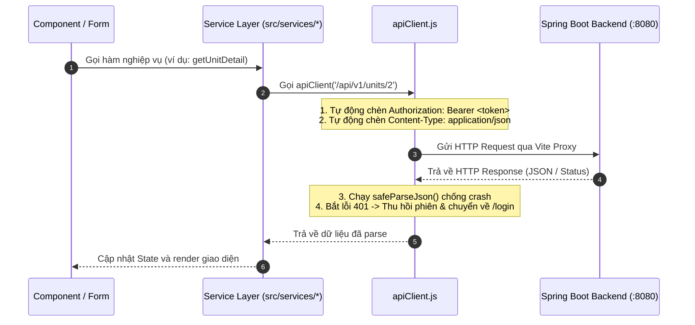

# Luồng Dữ Liệu & HTTP Client (`apiClient.js`)

Tài liệu này mô tả chi tiết cách thức Frontend gửi request, xác thực token và xử lý phản hồi từ Backend.

---

## 1. Vòng Đời Yêu Cầu (Request / Response Lifecycle)



---

## 2. Chi Tiết Lớp Mạng `apiClient.js`

### 2.1. Quản lý Token (`tokenStorage`)
Token JWT được lưu trữ trong `localStorage` với khóa `storagehub_token`:
- Khi đăng nhập: Lưu token vào storage.
- Khi đăng xuất hoặc hết hạn: Xóa sạch `storagehub_token` và `storagehub_user`.

### 2.2. Request Interceptor (Tự động gắn Header)
Mọi request qua `apiClient` đều tự động có:
```javascript
headers["Content-Type"] = "application/json";
if (token) {
  headers["Authorization"] = `Bearer ${token}`;
}
```

### 2.3. Response Interceptor (Bảo vệ phiên 401)
Nếu Backend trả về `401 Unauthorized` trên một route được bảo vệ:
1. Tự động xóa token khỏi storage.
2. Chuyển hướng người dùng về trang `/login`.
3. Báo lỗi: *"Phiên đăng nhập đã hết hạn. Vui lòng đăng nhập lại."*
*(Lưu ý: Nếu người dùng đang ở trang công khai như `/browse`, hệ thống không ép chuyển hướng để tránh gián đoạn trải nghiệm xem kho).*

### 2.4. Trình Phân Tích JSON An Toàn (`safeParseJson`)
Tránh lỗi `SyntaxError: Unexpected end of JSON input` khi Backend phản hồi body rỗng (như 204 No Content) hoặc lỗi sập socket dạng HTML:
```javascript
export async function safeParseJson(response) {
  try {
    const text = await response.text();
    if (!text || !text.trim()) return {};
    return JSON.parse(text);
  } catch {
    return {
      message: response.status >= 500
        ? "Không thể kết nối tới máy chủ. Vui lòng kiểm tra dịch vụ Backend."
        : `Máy chủ phản hồi mã ${response.status}`,
    };
  }
}
```

---

## 3. Chiến Lược Hybrid Fallback

- **Khi Backend đang chạy (Port 8080)**: 100% dữ liệu được đọc và ghi trực tiếp vào cơ sở dữ liệu MySQL thật.
- **Khi Backend tắt hoặc gặp lỗi mạng (`status >= 500`)**: Các service tự động chuyển sang dữ liệu mẫu dự phòng (Mock Fallback) khớp chuẩn V3, giúp QA/UX vẫn có thể kiểm thử giao diện và kịch bản demo mà không bị màn hình trắng (White Screen of Death).
